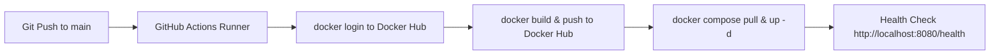
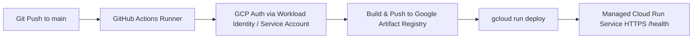

# Migration Guide: Moving CI/CD to Google Cloud Run

This document outlines the architectural and configuration mapping required to migrate the current Docker Hub and Docker Compose CI/CD pipeline to a cloud-native architecture on **Google Cloud Platform (GCP)** using **Google Artifact Registry** and **Google Cloud Run**.

---

## 1. Architecture Overview

### Current Architecture (Local / Docker Hub)


### Target Architecture (GCP Cloud Run)


---

## 2. Component Mapping Matrix

| Pipeline Component | Current Pipeline (Docker Hub + Compose) | Google Cloud Run Architecture |
| :--- | :--- | :--- |
| **Authentication** | Docker Hub credentials (`DOCKERHUB_USER`, `DOCKERHUB_TOKEN`) | Google Cloud Service Account Key or Workload Identity Federation (WIF) |
| **Container Registry** | Docker Hub (`${DOCKERHUB_USER}/app:${SHA}`) | Google Artifact Registry (`LOCATION-docker.pkg.dev/PROJECT_ID/REPO/app:${SHA}`) |
| **Build & Push** | `docker/build-push-action` targeting Docker Hub | `docker/build-push-action` authenticated via `google-github-actions/auth` |
| **Deployment Runtime** | Local/Runner VM Docker daemon via `docker compose up -d` | Google Cloud Run managed serverless container runtime via `gcloud run deploy` |
| **Traffic & Scaling** | Single host port mapping (`8080:8080`), static | Autoscaling (0 to N instances), built-in load balancer, HTTPS endpoint |
| **Health Verification** | `curl -f http://localhost:8080/health` against local host | Cloud Run revision health probe + HTTPS verification endpoint |

---

## 3. Step-by-Step Technical Migration

### Stage 1: Authentication Mapping
* **Current:** GitHub Actions logs in to Docker Hub using `docker/login-action` with static credentials stored in GitHub Secrets.
* **Cloud Run Migration:** Authentication is performed using **Workload Identity Federation (recommended)** or a dedicated **Service Account Key**:
  - The Service Account requires the following IAM roles:
    - `roles/artifactregistry.writer` (to push container images)
    - `roles/run.admin` (to deploy and manage Cloud Run revisions)
    - `roles/iam.serviceAccountUser` (to allow Cloud Run to act as the runtime service account)
  - GitHub Actions Step:
    ```yaml
    - name: Authenticate to Google Cloud
      uses: google-github-actions/auth@v2
      with:
        workload_identity_provider: 'projects/PROJECT_NUMBER/locations/global/workloadIdentityPools/POOL_ID/providers/PROVIDER_ID'
        service_account: 'ci-deployer@PROJECT_ID.iam.gserviceaccount.com'
    ```

### Stage 2: Registry Mapping (Artifact Registry)
* **Current:** Images are tagged `<DOCKERHUB_USER>/app:${{ github.sha }}` and stored on Docker Hub.
* **Cloud Run Migration:** A standard Docker repository is created in Google Artifact Registry:
  ```bash
  gcloud artifacts repositories create ci-repo \
      --repository-format=docker \
      --location=us-central1 \
      --description="Docker repository for CI/CD"
  ```
  - The container image URI becomes:
    `us-central1-docker.pkg.dev/${PROJECT_ID}/ci-repo/app:${{ github.sha }}`
  - Docker daemon is configured to authenticate with Artifact Registry:
    ```yaml
    - name: Configure Docker for Artifact Registry
      run: gcloud auth configure-docker us-central1-docker.pkg.dev
    ```

### Stage 3: Image Build and Selection
* The image is built using the existing `Dockerfile` without changes, maintaining strict immutability by tagging with the full Git commit SHA (`${{ github.sha }}`).
* Cloud Run directly references this immutable SHA tag for precise revision tracking and immediate zero-downtime rollbacks.

### Stage 4: Deployment Mapping (Docker Compose → Cloud Run)
* **Current:** Deployment runs `docker compose up -d`, binding host port `8080`.
* **Cloud Run Migration:** Replaced by `gcloud run deploy`:
  ```yaml
  - name: Deploy to Google Cloud Run
    uses: google-github-actions/deploy-cloudrun@v2
    with:
      service: ci-pipeline-service
      image: us-central1-docker.pkg.dev/${{ env.PROJECT_ID }}/ci-repo/app:${{ github.sha }}
      region: us-central1
      flags: |
        --port=8080
        --allow-unauthenticated
        --min-instances=0
        --max-instances=5
  ```
  - Cloud Run injects the `PORT` environment variable (default `8080`), matching `server.js`'s `process.env.PORT || 8080`.

### Stage 5: Health Check and Verification
* Cloud Run provides built-in startup and liveness probes.
* The GitHub Actions deployment step captures the deployed service URL from Cloud Run output and verifies the `/health` endpoint over HTTPS:
  ```yaml
  - name: Verify Health Check
    run: |
      SERVICE_URL=$(gcloud run services describe ci-pipeline-service --region us-central1 --format 'value(status.url)')
      curl -fail -sS "${SERVICE_URL}/health" | grep '"status":"ok"'
  ```

---

## 4. Key Advantages of Cloud Run over Compose
1. **Zero Infrastructure Maintenance:** No virtual machines, Docker daemons, or OS patches to manage.
2. **Auto-scaling:** Scales automatically down to zero when idle (zero cost) and scales out seamlessly on demand.
3. **Automated HTTPS & DNS:** Native TLS certificate provisioning without configuring Nginx or Let's Encrypt.
4. **Traffic Management:** Native support for canary rollouts, split testing, and instant rollbacks to previous SHA-tagged revisions.
